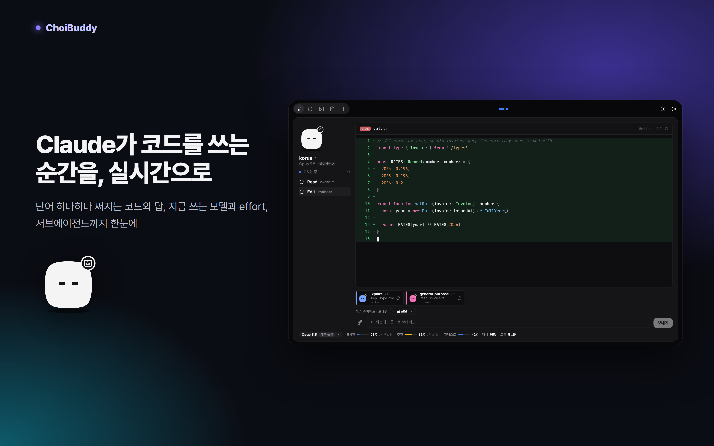
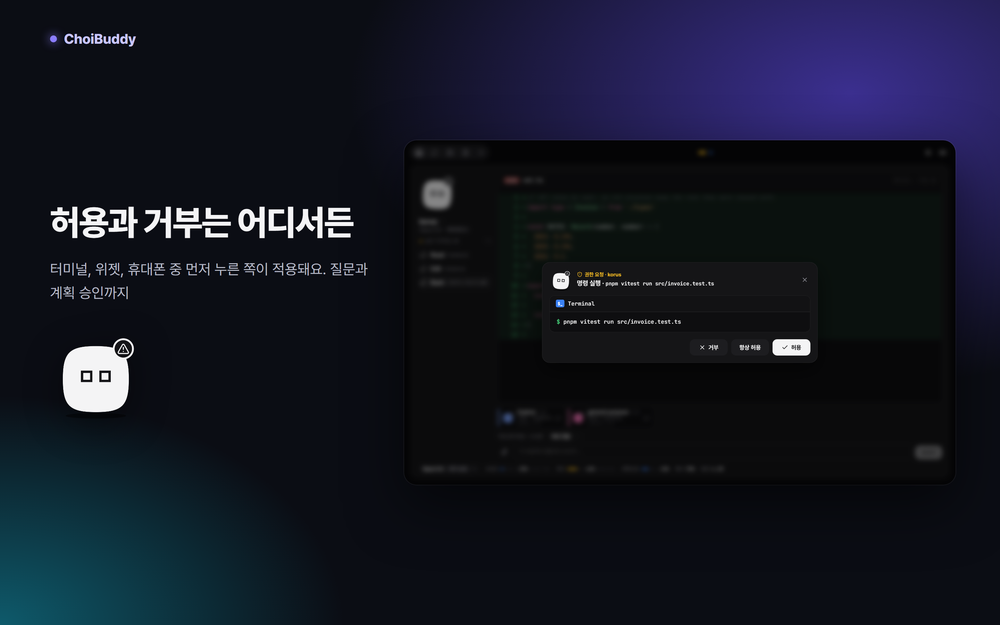
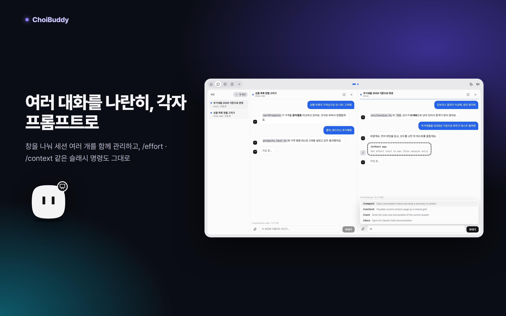
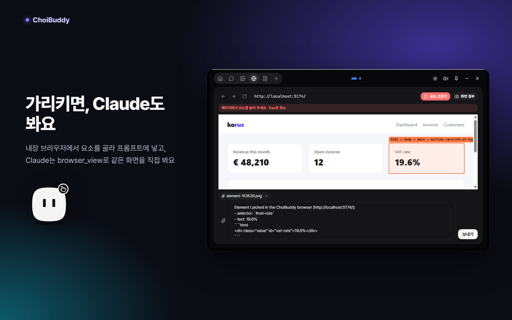
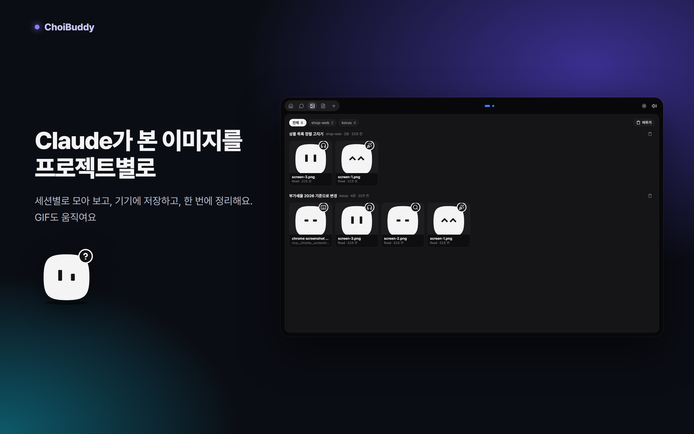
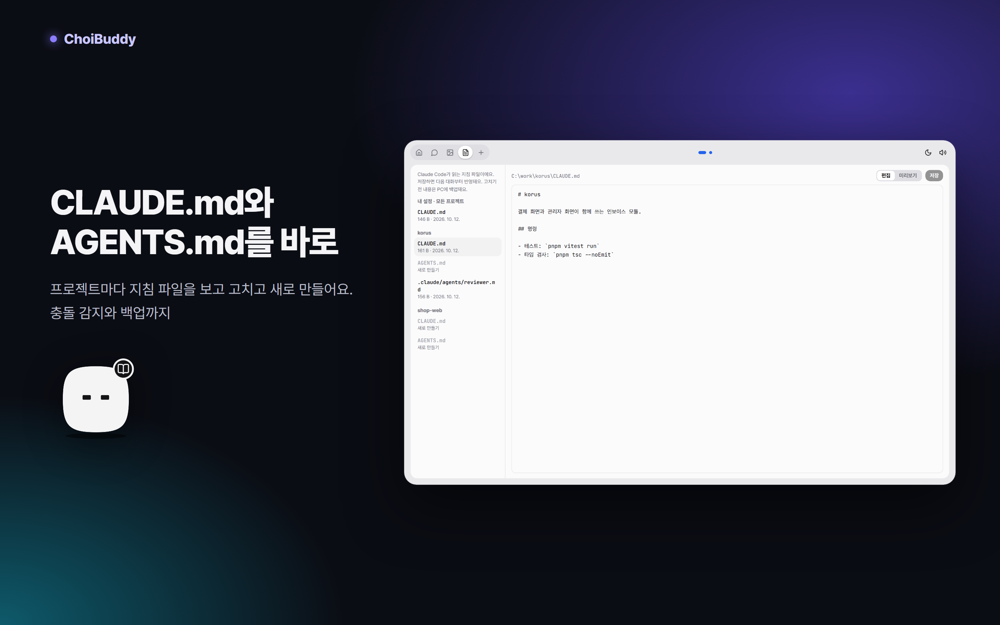
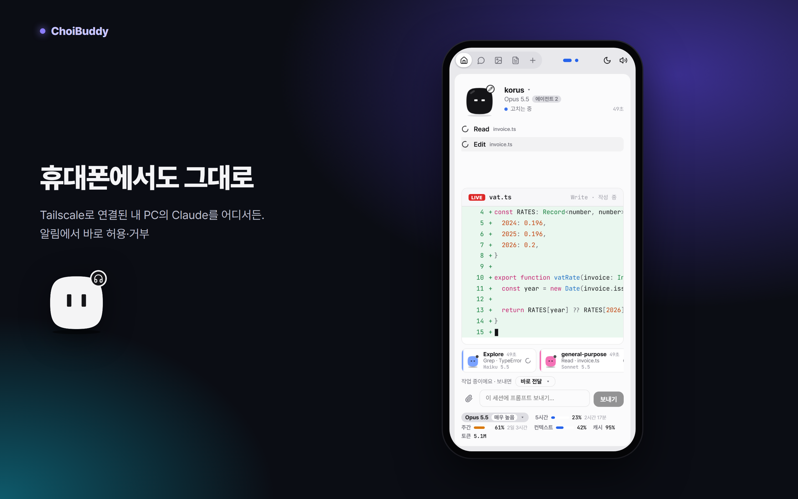
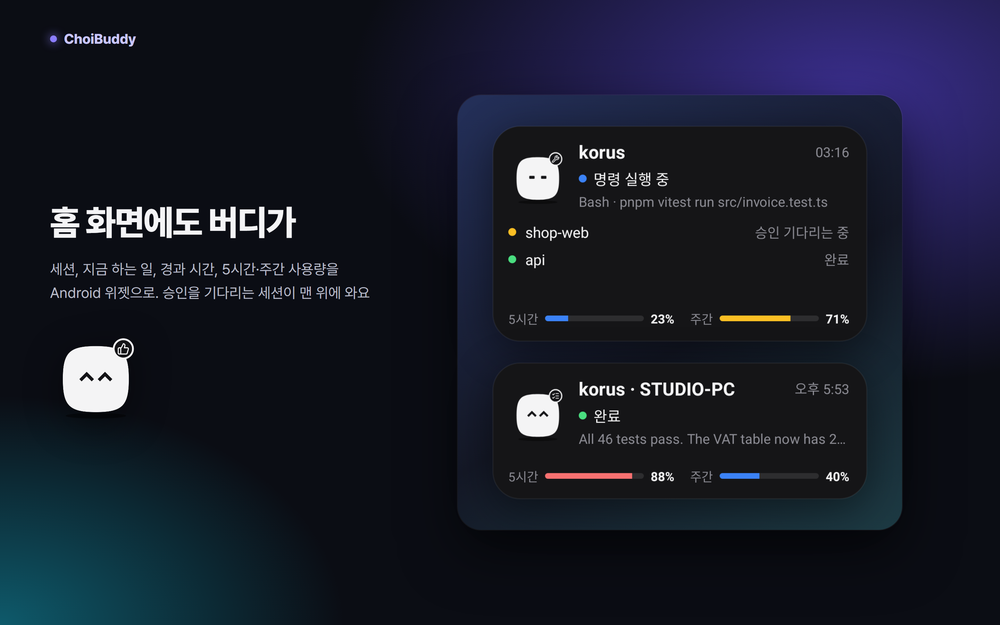
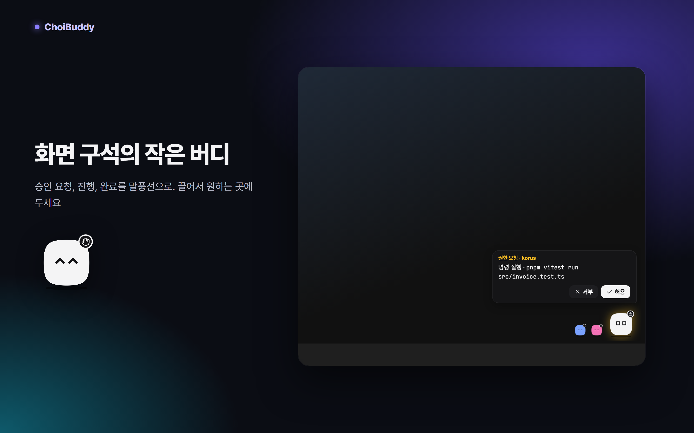

# ChoiBuddy

[English](README.md) · **한국어**

PC에서 돌아가는 Claude Code의 작업을 캐릭터와 함께 실시간으로 보여 주고, 권한 요청·질문·계획 승인을 윈도우 위젯이나 휴대폰에서 바로 답하게 해 주는 도구예요. 화면은 한국어, English, 日本語, Français를 지원해요.



**[최신 릴리스 내려받기](https://github.com/choidevhi/choibuddy/releases/latest)**: 윈도우 10/11용 `ChoiBuddy_<버전>_x64-setup.exe`, Android 8.0 이상용 `ChoiBuddy-<버전>.apk`

```
Claude Code ──훅(HTTP)──────▶ 브리지(Node, PC) ──SSE──▶ 윈도우 위젯 + 플로팅 버디 (Tauri)
            ──mod(사용량·프롬프트)─┘      └──Tailscale──▶ 안드로이드 앱 (WebView + 알림)
```

## 무엇을 하나



- **어디서든 승인.** 권한 요청(허용/거부/항상 허용), Claude의 질문(선택지 답), 계획 승인(승인/수정 요청). 터미널 대화상자와 **동시에** 뜨고, 먼저 누른 쪽이 적용돼요. 590초 안에 아무도 안 누르면 터미널 대화상자만 남아요.
- **지금 하는 일.** 읽는 파일, 고치는 줄(빨강/초록), 실행 중인 명령과 출력, 검색, 할 일 목록.
- **써지는 대로 보이는 코드.** Claude가 쓰고 있는 코드와 답이 한 단어씩 보여요(LIVE).
- **상태마다 다른 표정.** 생각 중, 읽기, 편집, 명령 실행, 승인 대기, 완료, 오류 등. 서브에이전트는 색이 다른 작은 캐릭터로 따로 보여요.
- **사용량.** 5시간·주간 한도, 컨텍스트, 토큰, 캐시 비율, 지금 쓰는 모델과 effort. 홈에서 모델과 effort를 바로 바꿔요.



- **대화 탭.** 세션 기록에서 대화 전체를 보고, 지난 세션도 골라 봐요. 프롬프트와 파일 첨부(홈 화면에서도), 끝난 대화 지우기, PC에서는 최대 4개 나란히 보기.
- **작업 중에 보낸 프롬프트(스티어링).** **바로 전달**(지금 도구가 끝나는 대로 들어가고 Claude가 이어서 반영), **끝나고 보내기**, **멈추고 보내기** 중에서 골라요.
- **슬래시 명령.** `/`를 치면 그 세션의 명령 목록이 나오고, 보내면 명령으로 실행돼 출력이 대화에 보여요.
- **새 세션.** PC·폴더·첫 프롬프트를 고르면 그 PC에 터미널로 Claude Code가 열려요.



- **내장 브라우저(윈도우).** 페이지에서 요소를 골라 프롬프트에 넣고, Claude는 `browser_view` 도구로 같은 화면을 봐요.



- **이미지 탭.** Claude가 연 이미지와 스크린샷을 프로젝트·세션별로 모아 봐요. GIF도 움직여요. 기기에 저장하고, 지우고, 한 번에 비워요.



- **문서 탭.** `CLAUDE.md`, `AGENTS.md`, 서브에이전트 정의를 PC별·프로젝트별로 보고 고치고 새로 만들어요. 충돌 감지와 백업까지 해요.



- **안드로이드 앱.** Tailscale로 어디서든 같은 화면을 봐요. 승인 알림에 [허용] [거부] 버튼이 있고, 작업이 끝나면 알려 줘요. 뒤로가기는 열린 것부터 닫고 앱을 내려요.



- **홈 화면 위젯(안드로이드).** 지금 자세의 버디, 세션, 지금 하는 일, 경과 시간, 5시간·주간 사용량. 승인을 기다리는 세션이 맨 위에 와요. 크게 늘리면 다른 세션 두 개까지, 작게 줄이면 버디와 상태만 보여요.



- **플로팅 버디(윈도우).** 승인 요청, 진행, 완료를 말풍선으로 알려요. 끌어서 원하는 곳에 두세요.
- **여러 PC.** 각 PC의 브리지를 함께 봐요.
- **Auto Accept.** 정해 둔 시간 동안 권한 요청을 자동으로 허용해요.

## 시작하기

필요한 것:

- Claude Code
- PATH에 Node.js 24 이상(브리지가 Node로 돌아요)
- 휴대폰이나 다른 PC를 쓸 때는 PC와 휴대폰 모두 [Tailscale](https://tailscale.com)

순서:

1. **윈도우 앱.** `ChoiBuddy_<버전>_x64-setup.exe`를 설치하고 **Claude Code에 연결**을 눌러요.
   - 브리지를 `~/.choibuddy/app`에 복사하고 `~/.claude/settings.json`에 훅을 추가해요. 원래 파일은 `settings.json.choibuddy-backup-<시각>`으로 먼저 백업돼요.
   - 동반 mod도 설치해요. 이미 열려 있던 Claude Code 세션에서는 `/reload-plugins`를 한 번 실행하세요.
   - 설치 파일에 코드 서명이 없어요. SmartScreen 경고가 뜨면 **추가 정보 → 실행**을 누르세요.
2. **휴대폰.**
   - `ChoiBuddy-<버전>.apk`를 설치해요. 브라우저나 파일 앱의 설치 허용을 물으면 허용해 주세요.
   - 윈도우 앱 **＋** 탭에서 **연결 코드 만들기**를 누르고, 나온 QR을 휴대폰 앱으로 찍어요.
   - PC와 휴대폰 모두 Tailscale에 로그인돼 있어야 해요.
3. **다른 PC.** 그 PC에도 설치하고, 거기서 만든 연결 링크를 이 PC 앱의 **다른 PC**에 붙여 넣어요. 휴대폰은 PC마다 QR을 하나씩 찍어요.

윈도우 앱 없이 이 저장소를 받아서 할 때:

```
corepack pnpm install
corepack pnpm install-bridge     # 브리지, 훅, mod 설치
corepack pnpm uninstall-bridge   # 훅을 지우고 브리지를 멈춤
```

## 보안

- **훅.** 훅 입력(`/hook`)은 이 PC의 Claude Code만 보낼 수 있어요. 127.0.0.1에서만 받고, 브라우저가 보내는 `Origin` 헤더가 있으면 거부해요.
- **공유기 안 다른 기기에는 안 열려요.** 브리지는 127.0.0.1과 Tailscale 주소(100.64.0.0/10)에만 열려요.
- **연결 코드.**
  - 화면용 API는 모두 코드가 필요해요. PC 앱 자신의 코드는 `~/.choibuddy/config.json`에 있어요.
  - 휴대폰·다른 PC는 기기마다 따로 받은 코드를 쓰고, 파일에는 해시만 남아요. 기기별로 끊거나 전체를 한 번에 바꿀 수 있어요.
  - 휴대폰 앱은 `choibuddy://` 링크로 PC를 더하기 전에 항상 물어봐요. 웹페이지가 몰래 연결하지 못해요.
- **원격 프롬프트.** 코드를 가진 기기만 보낼 수 있어요. bypass 모드에서는 프롬프트가 곧 PC에서의 실행이니, 코드를 PC 접근 권한처럼 다뤄 주세요.
- **파일.**
  - **올린 파일**은 `~/.choibuddy/uploads`에 저장되고, 이름의 경로 문자는 모두 지워요.
  - **이미지**는 Claude가 실제로 연 파일과 도구가 돌려준 스크린샷만 줘요. 임의 경로는 안 돼요. SVG는 스크립트가 돌지 않도록 격리해서 보내요.
  - **대화 지우기**는 진행 중이 아닌 세션의 기록만 `~/.choibuddy/trash`로 옮겨요. 이미지 지우기는 목록만 바꾸고, 브리지가 저장한 스크린샷만 실제로 지워요.
- **문서 탭.** 정해진 이름의 지침 파일만 읽고 써요. 목록에 나온 파일의 id로만, 1MB까지예요. 저장 전 내용은 `~/.choibuddy/doc-backups`에 백업해요. 지침 파일은 Claude의 행동을 바꾸므로, 코드를 가진 기기는 그만큼의 권한을 가져요.
- **Auto Accept.** 메모리에만 있어서 브리지가 다시 켜지면 꺼져요. 일반 권한 요청만 허용하고, 질문과 계획 승인은 사람이 답해야 해요.
- **새 세션.** 고른 폴더가 실제로 있을 때만 터미널을 띄워요. 셸을 거치지 않고 프로그램과 인자를 따로 넘겨요.
- **내장 브라우저.** 페이지에는 앱의 기능(IPC)이 열리지 않아요. 페이지가 앱에 알리는 것은 고른 요소와 주소뿐이에요. Claude의 `browser_view` 답은 이 PC의 앱만 보낼 수 있어요.

## 알아 둘 점

- 기본 권한 모드가 `bypassPermissions`이면 일반 권한 요청은 뜨지 않아요. Claude의 질문(AskUserQuestion)과 계획 승인은 그 모드에서도 떠요.
- 브리지가 꺼져 있으면 훅이 실패 메시지를 남길 수 있어요. 세션이 시작될 때와 프롬프트를 보낼 때 브리지를 자동으로 다시 띄워요.
- 실시간 코드와 사용량, 원격 프롬프트는 동반 mod가 필요해요. mod를 새로 깔거나 올린 뒤 이미 열려 있던 세션은 `/reload-plugins`를 한 번 실행하세요.

## 구성

| 폴더 | 내용 |
| --- | --- |
| `bridge/` | Node 24 서버(의존성 없음). 훅을 받아 상태를 만들고, 승인 요청을 붙잡고 있다가 답을 돌려줘요 |
| `shared/protocol.ts` | 브리지와 화면이 함께 쓰는 데이터 형식 |
| `ui/` | 화면(React). 윈도우 앱과 안드로이드 앱이 같은 빌드를 써요 |
| `windows/src-tauri/` | 윈도우 위젯(Tauri 2): 테두리 없는 창, 트레이, 항상 위, 시작 시 실행 |
| `android/` | 안드로이드 앱: WebView 화면, 승인 알림, 홈 화면 위젯 |
| `mod/` | Claude Code 안에서 도는 동반 mod: 사용량·모델·effort 보고, 원격 프롬프트와 슬래시 명령 전달, 쓰는 중인 코드와 답 전달, `browser_view` 도구 |
| `scripts/demo.ts` | 가짜 작업을 브리지에 흘려 화면을 확인하는 개발용 스크립트 |

## 빌드

```
corepack pnpm test         # 브리지 테스트
corepack pnpm typecheck    # 브리지 + 화면 타입 검사
corepack pnpm build        # 화면 빌드 (ui/dist)
corepack pnpm tauri build  # 윈도우 설치 파일
cd windows/src-tauri; cargo test
cd mod; claude plugin validate .; claude plugin test .
cd android; .\gradlew.bat --no-daemon testReleaseUnitTest assembleRelease lintRelease   # JAVA_HOME은 JDK 21
```

화면만 볼 때: 브리지를 시험용 포트로 띄우고(`CLAUDE_CONFIG_DIR`를 `<임시 폴더>/choibuddy-demo/claude`로) `node scripts/demo.ts --port <포트> --scene read|edit|bash|done|pending|question|plan|multi|agents|images|live|reply|command`를 실행한 뒤, 브라우저에서 `http://localhost:1430/#choibuddy://pair?u=...&t=...`를 열어요. 버전마다 바뀐 점은 [CHANGELOG.md](CHANGELOG.md)에 있어요.

## 라이선스

코드는 [MIT 라이선스](LICENSE)예요. ChoiBuddy 캐릭터 그림(버디 그림, 앱 아이콘, 홍보 이미지)은 MIT에 포함되지 않아요. 자세한 내용은 [LICENSE](LICENSE)를 보세요.
