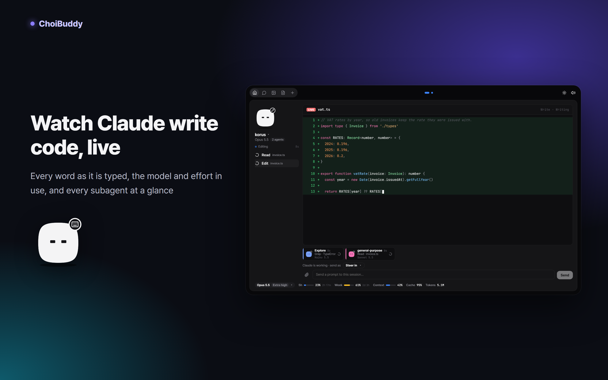
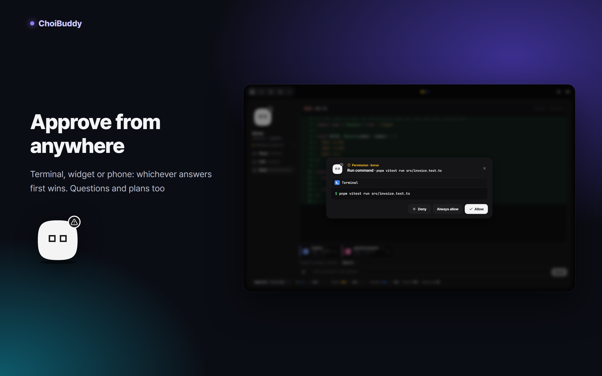
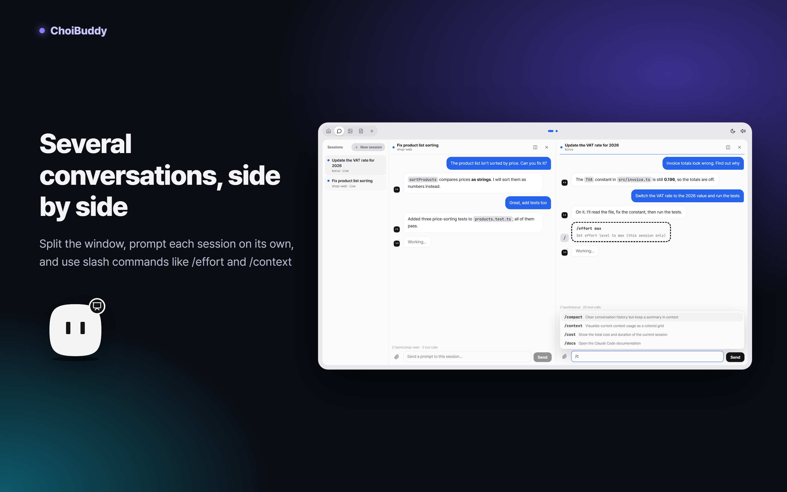
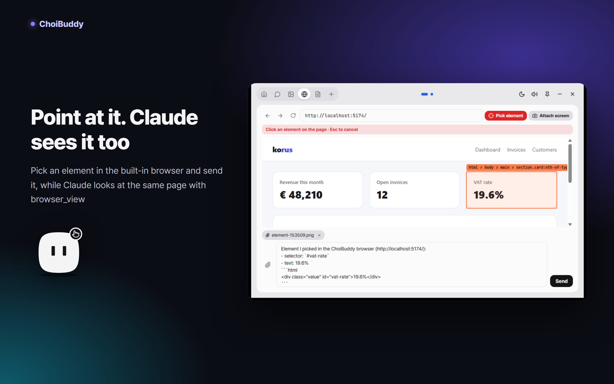
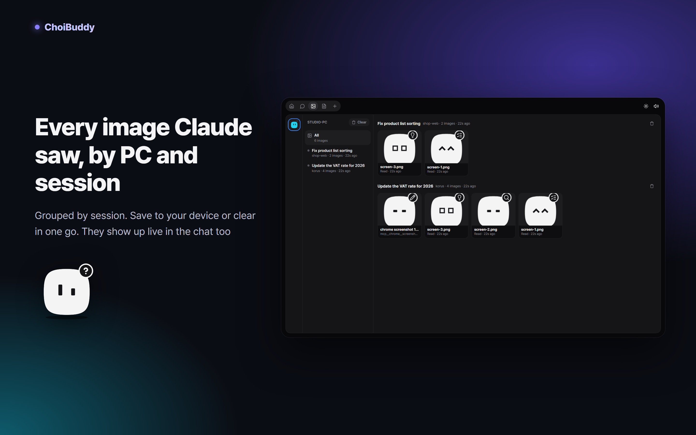
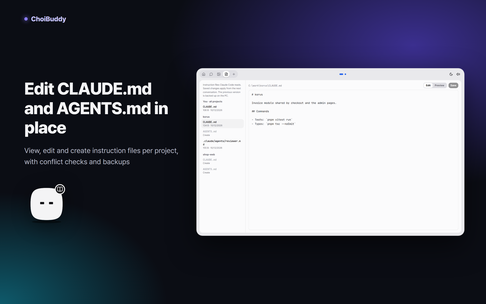
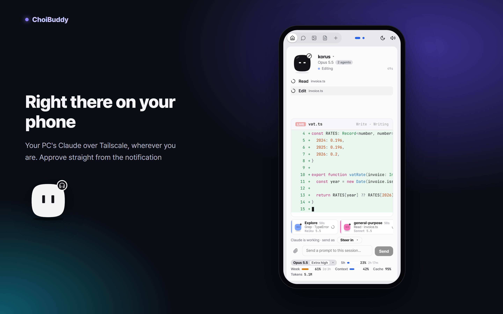
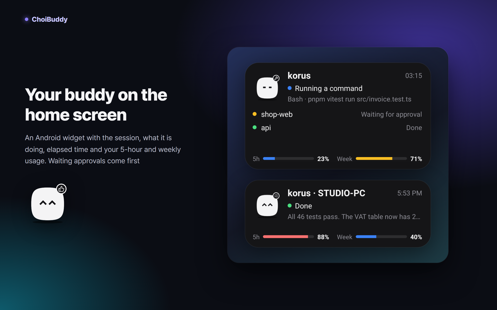
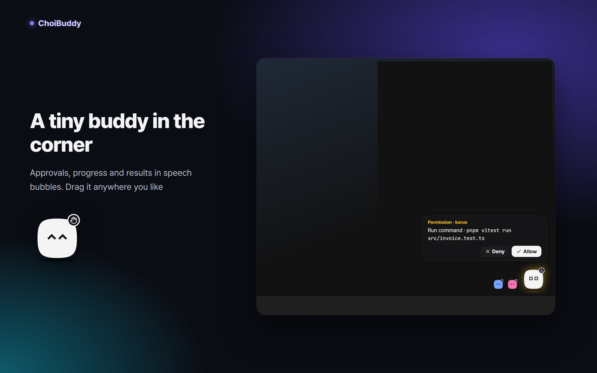

# ChoiBuddy

**English** · [한국어](README.ko.md)

ChoiBuddy shows what Claude Code is doing on your PC, live, with a little buddy, and lets you answer its permission requests, questions and plan approvals from a Windows widget or your Android phone. The app speaks English, 한국어, 日本語 and Français.



**[Download the latest release](https://github.com/choidevhi/choibuddy/releases/latest)**: `ChoiBuddy_<version>_x64-setup.exe` for Windows 10/11, `ChoiBuddy-<version>.apk` for Android 8.0 and later.

```
Claude Code ──hooks (HTTP)──────▶ bridge (Node, on the PC) ──SSE──▶ Windows widget + floating buddy (Tauri)
            ──mod (usage, prompts)─┘          └──Tailscale──▶ Android app (WebView + notifications)
```

## What you get



- **Approvals from anywhere.** Permission requests (allow, deny, always allow), Claude's questions (pick an answer) and plans (approve or ask for changes). They show up at the same time as the terminal dialog; whichever answers first wins. If nobody answers within 590 seconds, only the terminal dialog stays.
- **What it is doing right now.** Files it reads, lines it changes (red and green), commands and their output, searches and the todo list.
- **Code as it is written.** The code and the reply appear word by word while Claude types them (LIVE).
- **A buddy with a pose for every state.** Thinking, reading, editing, running a command, waiting for you, done, error and more. Subagents get their own small, coloured buddies.
- **Usage.** The 5-hour and weekly limits, context, tokens and cache hit rate, plus the model and effort in use. Change the model or effort right from the home screen.



- **PC by PC, everywhere.** Home, chat and images all start the same way. Your PCs sit on the left as buddies of their own colour (hover for the name). Next come the chosen PC's sessions: open ones, ended ones under a divider, and the archive. The view comes last.
- **Panes like tmux.** On a PC, split home or chat into up to 6 panes, left/right or top/bottom, and split a half again. Drag the lines to resize; the layout is remembered. A home pane follows whichever session is busy until you pick one for it.
- **Chat.** Whole conversations come from the session transcripts, with the pictures Claude opened and the ones you sent shown where they happened, live. Send prompts and attach files (from the home screen too). A prompt you send stays one bubble, dimmed while it waits in the queue, until the transcript has it, so nothing blinks. Each session keeps its own unsent draft and attachments, so you can switch sessions and come back to it.
- **Session menu.** Right-click a session (long-press on the phone) to rename it, end it (Claude Code gets `/exit`), reload its plugins (`/reload-plugins`), open a terminal in its folder, archive it or delete it. Ended sessions can be folded away, or archived or deleted all at once.
- **Older mod, one tap.** A session started before the companion mod was updated says so in the chat, with a button that runs `/reload-plugins` there as soon as the session is idle.
- **Terminal.** The terminal button above the session list opens a terminal on that PC (WezTerm, Windows Terminal or cmd), even when you press it on the phone.
- **Steering.** A prompt sent while Claude works can **steer in** (it lands as soon as the current tool finishes, and Claude carries on with it), wait until **after this task**, or **stop and send**.
- **Slash commands.** Type `/` for the session's commands. They run as commands and their output shows in the chat.
- **Codex too (beta).** Press "Connect Codex" in the ＋ tab on a Windows PC with Codex and restart Codex. ChoiBuddy adds its hooks and has Codex trust them, the same way Codex's own `/hooks` screen does. Codex sessions then show up with a tag: their steps (commands, patches), the conversation from Codex's own files, and its approval requests, which you can allow or deny from anywhere. Codex takes no prompts, slash commands or usage reports from outside, so those stay Claude Code only.
- **Auto language.** Turn it on in settings and, when Claude answers in a language other than the app's, ChoiBuddy asks the session once to restate the answer in yours (never a restatement again). It applies to every connected PC.
- **New sessions.** Pick a PC, a folder and a first prompt, and Claude Code opens in a new terminal on that PC.



- **Built-in browser (Windows).** Pick an element on a page and drop it into your prompt. Claude looks at the same page with the `browser_view` tool. Open it in its own tab or as a pane right of the session you are working on (the globe button on a pane). A session on another PC works too: when Claude there calls `browser_view`, the ChoiBuddy app with its browser open answers, whichever PC it runs on.



- **Images.** Every picture and screenshot Claude opened, PC by PC and session by session. GIFs play. Save them to your device, remove them or clear a PC's list.
- **Keyboard.** Ctrl+PageUp and Ctrl+PageDown move between the tabs.
- **Updates.** The apps check GitHub for a newer release every few hours and offer it in the top bar.
  - Windows downloads and installs it, then starts again. The bridge, hooks and mod follow by themselves once no approval is waiting, and Auto Accept stays on.
  - The phone downloads the APK for you to install.



- **Docs.** View, edit and create `CLAUDE.md`, `AGENTS.md` and subagent definitions, PC by PC (buddies on the left) and project by project, with conflict checks and backups.



- **Android app.** The same screens over Tailscale, wherever you are. Approval notifications with Allow and Deny buttons, a notification when a session finishes, and the back button closes what is open before it leaves the app.



- **Home-screen widget (Android).** The buddy in its current pose, the session, what it is doing, the elapsed time and your 5-hour and weekly usage. A session waiting for approval comes first. Make it bigger to see two more sessions, or smaller for just the buddy and the state.



- **Floating buddy (Windows).** Approvals, progress and results in speech bubbles. Drag it wherever you like. Right-click it to open ChoiBuddy, turn the sound on or off, reset its position, hide it or quit.
- **Several PCs.** Watch the bridges on all your PCs together. Turn on **Connect my Tailscale devices automatically** in a PC's danger zone and your other devices on the same Tailscale account connect to it without a code (a phone needs one PC paired by QR first).
- **Auto Accept.** Allow permission requests automatically for a set time.

## Getting started

You need:

- Claude Code
- [Tailscale](https://tailscale.com) on the PC and the phone, for the phone or other PCs. The apps put it there for you: **Install** in the **＋** tab runs winget on Windows and opens the Play Store on the phone. You only sign in.

Nothing else: the Windows app brings its own Node.js 24 for the bridge and Claude Code's hooks, so no Node install is needed.

Steps:

1. **Windows app.** Install `ChoiBuddy_<version>_x64-setup.exe` and press **Connect to Claude Code**.
   - It copies the bridge and the app's Node.js to `~/.choibuddy/app` and adds hooks to `~/.claude/settings.json`. The original file is backed up first as `settings.json.choibuddy-backup-<time>`.
   - It also installs the companion mod. Sessions that were already open show a "Reload plugins" button in the chat (or run `/reload-plugins` in them).
   - The installer is not code-signed. If SmartScreen warns, choose **More info → Run anyway**.
2. **Phone.**
   - Install `ChoiBuddy-<version>.apk`; Android asks you to allow installs from your browser or file app.
   - In the Windows app, open the **＋** tab, press **Create a pairing code** and scan the QR with the phone app.
   - The PC and the phone must both be signed in to Tailscale.
3. **Other PCs.** Install ChoiBuddy there as well, create a pairing code on that PC, and paste its link into **Other PCs** on this one. A phone scans one QR per PC.

Without the Windows app, from a clone of this repository (needs Node.js 24 or later; the bridge keeps a copy of the Node that installed it):

```
corepack pnpm install
corepack pnpm install-bridge     # bridge, hooks and mod
corepack pnpm uninstall-bridge   # removes the hooks and stops the bridge
```

## Security

- **Hooks.** Only Claude Code on this PC can send hooks (`/hook`): the bridge takes them from 127.0.0.1 only and refuses requests that carry a browser `Origin` header.
- **The bridge is not on your LAN.** It listens only on 127.0.0.1 and your Tailscale address (100.64.0.0/10).
- **Access codes.**
  - Every screen API needs a code. The PC app's own code is in `~/.choibuddy/config.json`.
  - Phones and other PCs each get their own code, and only its hash is stored. You can cut devices off one by one, or replace every code at once.
  - On the phone, a `choibuddy://` link always asks before it adds a PC, so a web page can't pair it quietly.
- **Remote prompts.** Only a device with a code can send prompts. In bypass mode, a prompt runs on the PC, so treat a code like access to the PC.
- **Files.**
  - **Uploads** go to `~/.choibuddy/uploads`, with path characters stripped from their names.
  - **Images** are limited to files Claude actually opened and screenshots tools returned; no other path can be requested. SVGs are sent isolated so their scripts can't run.
  - **Deleting** a conversation moves only a finished session's transcript to `~/.choibuddy/trash`. Removing an image only changes the list; just the screenshots the bridge saved are deleted.
- **Docs tab.** It only reads and writes instruction files with known names, by their id from the list, up to 1 MB. Each file is backed up to `~/.choibuddy/doc-backups` before it is saved. Instruction files change how Claude behaves, so a device with a code has that much power too.
- **Auto Accept.** It lives in memory only, so it turns off when the bridge restarts. It allows ordinary permission requests only; questions and plans always need a person.
- **Connecting Tailscale devices automatically.** Off unless you turn it on for this PC. A device then gets a code of its own only over Tailscale, and only when Tailscale says it is signed in to the same account as this PC. Devices shared with you and tagged devices are left out. Each one shows in the device list and can be cut off, and turning the option off cuts all of them. Anyone who can sign in to your Tailscale account could connect, so keep that account safe.
- **Ending a session** and **reloading its plugins** send `/exit` and `/reload-plugins` through the companion mod, the same as typing them in the terminal.
- **Codex.** ChoiBuddy writes its hooks to `~/.codex/hooks.json` only when you press "Connect Codex" on this PC (not from a phone), keeps your own hooks there, and saves the file before to `hooks.json.bak`. Codex runs only hooks it trusts: pressing the button also asks Codex's own app-server (`codex app-server`, `hooks/list` then `config/batchWrite`) to trust ChoiBuddy's hooks, as `/hooks` would, and nothing else. When an update changes the hooks, the bridge writes and trusts them again, only while connected. An approval answer to Codex is only allow or deny.
- **Auto language** reads only the reply text Claude Code hands to its Stop hook, decides the language on the bridge (code, paths and links left out), and sends one prompt through the companion mod. Any connected device may turn it on or off. Names and the archive live in `~/.choibuddy/sessions.json`; Claude Code's transcripts are not changed.
- **New sessions and terminals.** A terminal opens only when the folder exists, and it starts without going through a shell (the program and its arguments are passed separately). A device with a code can open a terminal window on the PC, but cannot type into it.
- **Built-in browser.** Pages get no access to the app's IPC; a page can only send the app the element you picked and its address. Claude's `browser_view` calls are answered by a connected ChoiBuddy app with its browser open (this PC's, or another PC's that has this one connected); the first answer counts. A device that may send prompts may show Claude a page too. An app whose browser is closed waits 3 seconds before saying so, so an open one answers first.

## Good to know

- With `bypassPermissions` as the default mode, ordinary permission requests never come up. Questions (AskUserQuestion) and plan approvals still do.
- If the bridge is down, a hook can leave a failure message. The bridge starts again by itself when a session starts or a prompt is sent.
- Live code, usage and remote prompts need the companion mod. After installing or updating it, sessions that were already open need `/reload-plugins` once: the chat offers a button for it, or type it in the terminal.

## Project layout

| Folder | What is in it |
| --- | --- |
| `bridge/` | Node 24 server with no dependencies. It turns hooks into state and holds approval requests until someone answers |
| `shared/protocol.ts` | The data types the bridge and the screens share |
| `ui/` | The screens (React). The Windows and Android apps use the same build |
| `windows/src-tauri/` | The Windows widget (Tauri 2): frameless window, tray, always on top, start with Windows |
| `android/` | The Android app: the screens in a WebView, approval notifications and the home-screen widget |
| `mod/` | The companion mod that runs inside Claude Code: usage, model and effort, remote prompts and slash commands, the live stream, the `browser_view` tool |
| `scripts/demo.ts` | Feeds made-up work to a bridge, for checking the screens |

## Building

```
corepack pnpm test         # bridge tests
corepack pnpm typecheck    # bridge and screens
corepack pnpm build        # screens (ui/dist)
corepack pnpm tauri build  # Windows installer (first fetches Node.js into windows/src-tauri/runtime, checked against a pinned SHA-256)
cd windows/src-tauri; cargo test
cd mod; claude plugin validate .; claude plugin test .
cd android; .\gradlew.bat --no-daemon testReleaseUnitTest assembleRelease lintRelease   # JDK 21 in JAVA_HOME
```

To look at the screens without real work, start a bridge on a spare port with `CLAUDE_CONFIG_DIR` set to `<temp>/choibuddy-demo/claude`, run `node scripts/demo.ts --port <port> --scene read|edit|bash|done|pending|question|plan|multi|agents|images|live|reply|command`, and open `http://localhost:1430/#choibuddy://pair?u=...&t=...` in a browser. See [CHANGELOG.md](CHANGELOG.md) for what changed in each version.

## License

The code is under the [MIT License](LICENSE). The Windows app ships Node.js, which has its own license (installed next to it as `runtime/LICENSE`). The ChoiBuddy character artwork (the buddy drawings, app icons and promo images) is not covered by it; see [ARTWORK.md](ARTWORK.md).
